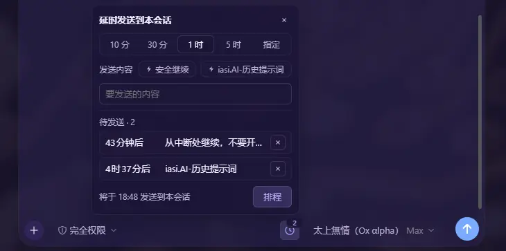
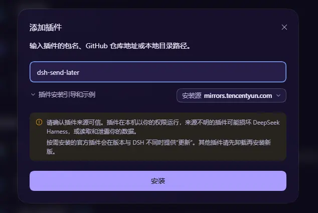

# dsh-send-later

  
  
  
  

<b>延时发送</b> —— 为 DeepSeek Harness（DSH）打造的定时消息插件。 
在输入框旁设定延时或指定时间，到点自动向当前会话发送一条消息（默认「继续」）。

典型场景：Coding Plan 五小时额度用尽时排程一条「继续」，额度恢复后自动续跑会话，全程无需人工值守。

## ✨ 功能特性

- **预设与指定时间**：发送按钮左侧的时钟按钮开箱即用，提供 10 分钟 / 30 分钟 / 1 小时 / 5 小时四档预设，或指定任意日期和时间；发送内容默认「继续」，可自由修改。
- **快捷片段条**：「发送内容」旁固定两颗快捷胶囊——`⚡安全继续`（带边界的继续文案）与最近一条自定义输入；自定义文案在排程成功后自动记录，长文案原地截断、悬停查看全文。
- **待发送管理**：按钮角标实时显示本会话待发送数量；面板内逐条列出（相对时间，悬停看绝对时刻），点 ✕ 即可取消。
- **智能默认时间**：已安装 [dsh-quota-watch](https://github.com/iasiv5/dsh-quota-watch) 时，点「指定」自动预填 GLM 5 小时窗口恢复时刻 + 2 分钟余量（无数据时回退为一小时后）；额度数值本身不做任何展示。
- **记忆与移动端适配**：上次使用的发送内容与时长自动记忆；软键盘弹出时面板自动避让（visualViewport 感知），窄屏（<480px）下面板贴底全宽展示。
- **可靠投递**：投递依托 DSH 官方自动化任务（`schedule`），任务持久化、重启不丢；可在「自动化任务」页查看、暂停或删除。
- **零配置**：纯前端插件，无 Host 侧代码，无需任何配置。

## 📥 安装

要求 DSH ≥ 0.2.2-rc.1。以下两种方式任选其一。

### 方式一 · DSH 官方插件页直装

1. 打开 DSH 的「插件管理」页，点击「添加插件」；
2. 输入包名 `dsh-send-later`（或 GitHub 仓库地址 `iasiv5/dsh-send-later`）；
3. 选择可用安装源，点击「安装」，完成后刷新页面即可生效。

### 方式二 · dsh-m 插件市场搜索安装

已安装 [DSH Marketplace（dsh-m）](https://github.com/iasiv5/dsh-m) 时，从侧栏进入「插件市场」，搜索关键词「延时发送」或 `send-later`，在卡片详情页一键安装。

npm 包 [dsh-send-later](https://www.npmjs.com/package/dsh-send-later) 与本仓库同步发布；`0.0.x` 为占位版本，请使用 0.2.0 及以上。

## 🚀 使用

1. 点击发送按钮左侧的时钟按钮，打开延时发送面板；
2. 选择预设时长或「指定」日期与时间，填写发送内容（或点选快捷片段），点击「排程」；
3. 面板下方的待发送列表支持随时取消（点 ✕）；到点后消息自动发送至当前会话。

## ⚠️ 已知限制

- 到点时若模型额度尚未恢复，该消息投递失败，需重新排程（额度恢复时间仅供参考，以服务商实际刷新为准）。
- 额度恢复时间依赖 dsh-quota-watch 提供的数据；未安装时该行自动隐藏。
- 会话被归档后，投递将被拒绝。
- DSH Host 必须在线才能完成投递；停机期间错过的一次性任务如何补发，尚未测试。
- 待发送列表按「本插件创建的任务 + 带标题前缀的同会话任务」识别；在「自动化任务」页修改标题前缀后将不再被识别。

## 📄 许可

[MIT License](LICENSE)。
